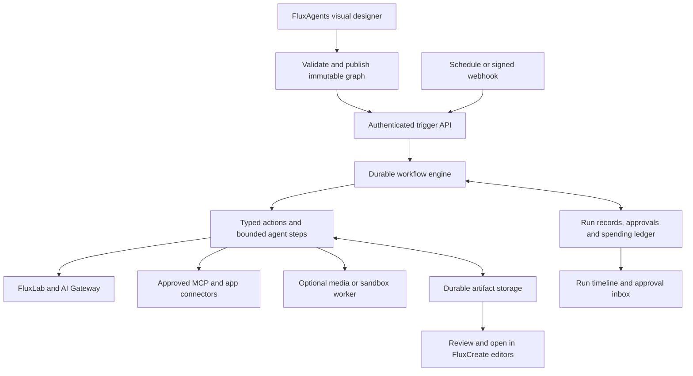

# FluxAgents: technology, reliability and cost research

Research date: **9 October 2026**. Status: **research and proposed architecture; FluxAgents has not been implemented**.

## Decision

Build FluxAgents as a distinct FluxCreate app with its own visual designer and portable workflow definition. My first choice to evaluate is **React Flow + a FluxAgents graph interpreter + Vercel Workflow SDK + the existing AI Gateway/FluxLab services**. Use ordinary typed actions for predictable work and bounded agent loops for tasks that need judgment. **Eve is the first agent harness to evaluate**, particularly for tools, subagents, skills and persistent conversations; it does not need to sit inside every simple generation step.

The strongest alternative is **Mastra core + Inngest**, with our own editor. **LangGraph.js** is worth including when complex branching agent state is central. **Cloudflare Agents/Workflows** is the cost-focused hosting challenger; **Temporal** is the reliability-focused orchestration benchmark. These are recommendations from documentation and the existing suite, not measured winners. The failure tests below must determine the production choice.

This separates three decisions that vendors often combine: the interface people design in, the agent's model/tool loop, and the service that keeps work running after the browser or server disappears. We should own the first and reuse established technology for the latter two.

## Scope and evidence

Working assumption: the first audience is individuals and small teams creating creative and business workflows. The user has not yet specified workload volume or a monthly operating budget. “Eve” is interpreted as [Vercel Eve](https://eve.dev/), rather than the unrelated Evolutionary Ensemble or Eden.art projects.

Research uses current official documentation, source licences, repositories and pricing pages. Product claims establish documented capabilities, not independently proven availability or reliability. No framework was installed, no benchmark was run, no new service account was created, and no paid model call was made for this research. Prices are snapshots in the stated currency, exclude taxes, and may vary with plan, region or contract. A framework's permissive licence does not cover every commercial companion product.

## What the current suite already gives us

The local source inspection found a React/Node 24 suite, a shared visual shell, a server-only Gateway connection, FluxLab generation services, and a working Markdown exchange format. This is a strong reason to prefer a TypeScript implementation initially.

Important existing boundaries:

- The hosted API dispatcher has a 120-second invocation limit. It is an entry point for starting or inspecting work, not a place to keep a days-long loop alive.
- FluxLab's durable media library is currently browser IndexedDB. A cloud agent cannot retrieve another browser's local Blob collection while that browser is closed. Background workflows need server-owned artifact storage and explicit uploads.
- FluxLab's MCP transport is currently local stdio. Cloud integration should call the shared service or introduce authenticated remote transport; there is no existing hosted MCP endpoint to reuse.
- Vercel deployment protection protects the current private suite. A multi-user FluxAgents product additionally needs application identities, workspace permissions and authenticated webhook/approval endpoints.
- Existing shared SDK dependencies include AI SDK 5. A new app can isolate its newer framework dependencies and reuse the connection/service contracts without upgrading every editor at once.
- `.flux.md` currently carries validated JSON in one authoritative fenced block. It is a useful exchange pattern, not a scheduler or executable Markdown language.

Source inspection: [FluxLab service contract](../../FluxLab/README.md), [Flux Exchange](../../FluxExchange/README.md), [deployment configuration](../deploy/vercel.json), [shared application registry](../shared/registry.mjs).

## Framework comparison

| Candidate | What it supplies | Reliability or integration caveat | Assessment for FluxAgents |
|---|---|---|---|
| **Eve** | TypeScript agent harness over AI SDK and Workflow: sessions, tools, skills, subagents, channels, approvals and evaluations. | File-based authoring needs our visual abstraction. Interrupted steps can rerun. Cron approvals require the correct channel/handler path. | Best first harness candidate for the existing suite; pin versions and test failure behavior. [Execution model](https://eve.dev/docs/concepts/execution-model-and-durability) |
| **Mastra** | Broad agent, memory, workflow, MCP, tracing and evaluation stack. | Recovery mode, persistent storage and execution runner must be configured; automatic multi-replica recovery needs coordination. | Strongest integrated alternative, especially if memory and delegation matter immediately. [Durable agents](https://mastra.ai/docs/harness/durable-agents) |
| **AI SDK + Workflow SDK** | Model/tool primitives plus durable steps, replay, waits and hooks. | AI SDK alone is not a background runtime. Our app owns graph semantics, authorization, budgets and business records. | Recommended baseline to evaluate: minimal overlap with existing Gateway services. [Durable agents](https://workflow-sdk.dev/docs/ai), [approval hooks](https://workflow-sdk.dev/docs/ai/human-in-the-loop) |
| **LangGraph.js** | Explicit state graphs, persisted checkpoints, branching and interrupt/resume. | Memory-only checkpoints are insufficient; resumption can rerun node code. Needs workers and scheduling around the library. | Strong choice for complex agent graphs; avoid a second competing workflow history for simple nodes. [Persistence](https://docs.langchain.com/oss/javascript/langgraph/persistence), [interrupts](https://docs.langchain.com/oss/javascript/langgraph/interrupts) |
| **Inngest AgentKit** | Agents, networks, routing and shared state, backed by Inngest execution. | AgentKit and the durable service are separate; external side effects still need deduplication. | Useful alternative to a larger agent framework when event-driven orchestration is the priority. [Deployment](https://agentkit.inngest.com/concepts/deployment), [approval](https://agentkit.inngest.com/advanced-patterns/human-in-the-loop) |
| **OpenAI Agents SDK, TypeScript** | Agent loops, tool approvals, handoffs, MCP, tracing and serializable run state. | AI SDK adapter is beta. Temporal's TypeScript integration is prerelease and does not support nested-agent approval interruptions. | Useful inside bounded agent nodes; less attractive as the entire first workflow platform with our Gateway requirement. [AI SDK adapter](https://openai.github.io/openai-agents-js/extensions/ai-sdk/), [Temporal integration](https://github.com/temporalio/documentation/blob/main/docs/develop/typescript/integrations/openai-agents.mdx) |
| **PydanticAI** | Typed Python agents, deferred tools, evaluations, provider integrations and durable-backend adapters. | Adds a Python service. Durability comes from Temporal, DBOS or Prefect, not conversation history alone. | Best Python option if data/scientific workflows become central. [Durability](https://pydantic.dev/docs/ai/capabilities/durable_execution/overview/), [Gateway integration](https://vercel.com/docs/ai-gateway/ecosystem/framework-integrations/pydantic-ai) |
| **Microsoft Agent Framework** | Agent and graph workflows, checkpoints, human input, telemetry and Durable Task integration. | Primary Python/.NET implementations introduce another backend stack; Gateway compatibility needs an integration test. | Stronger fit for an Azure/.NET organization than this initial suite. [Durable hosting](https://learn.microsoft.com/en-us/agent-framework/hosting/azure-functions), [repository](https://github.com/microsoft/agent-framework) |
| **Cloudflare Agents** | Stateful actors, SQLite-backed state, schedules, recoverable fibers and integration with Workflows. | In-memory timers and fetches do not survive eviction; select the durable primitive deliberately. | Serious alternative for many mostly idle agents, at the cost of a second platform and runtime constraints. [Long-running agents](https://developers.cloudflare.com/agents/concepts/agentic-patterns/long-running-agents/) |

LangGraph and PydanticAI have documented Gateway recipes. OpenAI's adapter provides a route through AI SDK, but adapter feature coverage still needs testing. A generic OpenAI-compatible URL is not proof that every provider-specific tool, structured output or media feature works. [LangChain/Gateway](https://vercel.com/docs/ai-gateway/ecosystem/framework-integrations/langchain), [OpenAI adapter](https://openai.github.io/openai-agents-js/extensions/ai-sdk/).

Additional candidates screened:

- **CrewAI:** MIT Python core with Flows, checkpoints and approval/resume. Automatic checkpoint writes are documented as best effort; production runtime behavior needs separate validation. It adds a Python service without a clear advantage over this TypeScript shortlist for the present suite. [Licence](https://raw.githubusercontent.com/crewAIInc/crewAI/main/LICENSE), [checkpoints](https://docs.crewai.com/en/concepts/checkpointing), [approvals](https://docs.crewai.com/en/learn/human-feedback-in-flows)
- **Google ADK:** several language SDKs, including Apache-2.0 TypeScript. Current resume documentation identifies Python and Kotlin rather than TypeScript, so language feature parity must not be assumed. Worth reconsidering for a Google Cloud deployment. [TypeScript](https://github.com/google/adk-js), [resume support](https://adk.dev/runtime/resume/), [deployment](https://adk.dev/deploy/)
- **AutoGen / Semantic Kernel:** for a new Microsoft-based implementation, compare their documented successor, Microsoft Agent Framework, instead of treating the three as independent greenfield choices. This does not mean every older project is unsupported. [Microsoft overview](https://learn.microsoft.com/en-us/agent-framework/overview/)

The examined LangGraph.js, PydanticAI, OpenAI Agents JS and Microsoft Agent Framework core licences are MIT. That permits a different product strategy from licensing their hosted companions; it does not eliminate hosting and maintenance costs. [LangGraph licence](https://github.com/langchain-ai/langgraphjs/blob/main/LICENSE), [PydanticAI licence](https://github.com/pydantic/pydantic-ai/blob/main/LICENSE), [OpenAI licence](https://github.com/openai/openai-agents-js/blob/main/LICENSE), [Microsoft licence](https://github.com/microsoft/agent-framework/blob/main/LICENSE).

### Eve: particularly good fit, with concrete conditions

Eve's source package observed during research was 0.75.1, with Node 24+, and an Apache-2.0 licence. It has a documented self-hosted Nitro/Postgres path as well as managed Vercel deployment. That makes it a credible reusable foundation rather than an obligatory paid editor. Hosting, models, tools and sandbox use still incur their own costs. [Package](https://raw.githubusercontent.com/vercel/eve/main/packages/eve/package.json), [licence](https://raw.githubusercontent.com/vercel/eve/main/LICENSE), [self-hosting](https://eve.dev/docs/guides/deployment/self-hosting).

Three details are essential to our product design:

1. **Schedules are not automatically an approval inbox.** Markdown schedules have no channel, discard replies and fail when a tool needs approval. Handler schedules can hand work to a channel and wait durably. Each firing normally creates a new session. FluxAgents must own the job record, overlap policy and approval destination. [Schedules](https://eve.dev/docs/schedules)
2. **A session cap is not the complete bill.** Eve's cost cap uses reported model-token cost, excludes infrastructure and tools, and allows the threshold-crossing call to finish. Dollar and output-token caps are unset by default. FluxAgents must set explicit limits and maintain its own reservations and ledger. [Agent configuration](https://eve.dev/docs/agent-config)
3. **Authored tools are trusted server code.** They are not automatically isolated merely because Eve also has sandbox support. Tool failures may be returned to the model rather than handled by a generic retry policy. We need typed tool adapters with explicit permissions and retry behavior. [Tools](https://eve.dev/docs/tools)

Readiness is qualified: Vercel introduced Eve as public preview and current Vercel navigation still labels it beta, while the Eve homepage uses production-ready language. Its changelog includes breaking changes; 0.75.1 describes Workflow 5.2 while some deployment documentation still references 5.0 beta. Pin a tested release set instead of building around `latest`. [Introduction](https://vercel.com/blog/introducing-eve), [current Vercel documentation](https://vercel.com/docs/workflows/pricing), [Eve changelog](https://eve.dev/changelog).

### Mastra: the strongest challenger

Mastra's new JSON-defined dynamic workflows closely match a visual builder: definitions reference registered components, can persist without redeployment, and running jobs retain their original graph. However, that API is explicitly beta. Our own versioned graph format should remain the product boundary even if we adopt it. [Dynamic workflows](https://mastra.ai/docs/workflows/dynamic-workflows).

Automatic durable-agent recovery defaults to off. With it enabled, interrupted model/tool work and whole delegated subagent calls can repeat. Multiple recovery replicas need coordination. This does not make Mastra unsuitable; it means a default instance is not our entire unattended execution system. Its documented Inngest runner is a stronger candidate than assuming the in-process mode provides distributed recovery. The Temporal runner is explicitly experimental. [Recovery behavior](https://mastra.ai/docs/harness/durable-agents), [workflow runners](https://mastra.ai/docs/deployment/workflow-runners).

Its memory, subagent and MCP capabilities can save application work. They also introduce additional storage, model calls and policy decisions. Persistent memory should be scoped to a workspace and task, with an inspect/delete interface. Do not share an unrestricted conversation memory between customers. [Memory](https://mastra.ai/docs/memory/overview), [subagents](https://mastra.ai/docs/subagents), [MCP](https://mastra.ai/docs/connections/mcp).

Licensing changes the editor decision: the current core is Apache-2.0 outside enterprise `ee/` paths; the ready-made Agent Builder requires an enterprise licence in production. We should build the FluxAgents interface ourselves unless commercial terms prove worthwhile. Older summaries describing all of Mastra as MIT are insufficient. [Current licence](https://mastra.ai/docs/license), [Agent Builder](https://agent-builder.mastra.ai/).

## Execution engines and hosting

| Engine | Why consider it | What we still operate or implement |
|---|---|---|
| **Vercel Workflow SDK** | Durable steps/hooks; matches existing hosting. The current Worlds registry includes an official Postgres backend with graphile-worker. | Graph interpreter, application database, artifact storage and permissions. Self-hosting shifts queue/database operations to us. Dynamic-source workflow authoring is experimental; our stable interpreter can avoid that API. [Worlds](https://workflow-sdk.dev/worlds), [Vercel Workflows](https://vercel.com/docs/workflows) |
| **Inngest** | Event-driven durable functions, steps, waits, concurrency and operational visibility; integrates with Mastra. | Hosted subscription plus application compute, or self-hosted database/queue operations and licence assessment. Event deduplication's documented 24-hour window is not permanent business deduplication. [Durability](https://www.inngest.com/docs/durable-execution), [idempotency](https://www.inngest.com/docs/durable-execution/guides-and-advanced/idempotency) |
| **Trigger.dev** | Task execution and queues suited to browser work, media tools and longer native processing. | Machine sizing, task adapters, application records and model policy. Current self-hosted offering lacks cloud checkpoint/warm-start/autoscaling parity. [Product](https://trigger.dev/product), [self-hosting differences](https://trigger.dev/enterprise) |
| **Temporal** | Explicit event history, recovery, durable timers, signals and versioning concepts; useful reliability benchmark. | Workers, deterministic workflow code and Activity boundaries. Do not dismiss it using an outdated minimum-price assumption. [Execution model](https://docs.temporal.io/workflow-execution), [current pricing](https://temporal.io/pricing) |
| **Cloudflare Workflows** | Persisted steps, retries and waits with CPU-based workflow billing. | Workers-compatible adapters and separate artifact storage. Paid limits include 1MiB non-stream step results and 30-day completed-state retention; keep large creative files elsewhere. [Rules](https://developers.cloudflare.com/workflows/build/rules-of-workflows/), [limits](https://developers.cloudflare.com/workflows/reference/limits/) |
| **DBOS / Prefect** | DBOS provides a compact Postgres-backed durable route; Prefect suits Python processing pipelines. | Database/workers and application UX; select only if the Python or self-hosting case wins. [DBOS](https://github.com/dbos-inc/dbos-transact-py), [Pydantic/Prefect](https://pydantic.dev/docs/ai/capabilities/durable_execution/prefect/) |

Use **one engine to own the main graph's execution history**. A media task can run on a specialized worker through a durable job reference. Installing Eve, Mastra, LangGraph, Inngest and Temporal together would create overlapping state, cost and recovery mechanisms without proving a user benefit.

One self-hosting distinction matters: AgentKit is Apache-2.0, but the current Inngest server licence is SSPL with an Apache future grant after a release's third anniversary. The server should not be described as unrestricted Apache today. Trigger's Apache core likewise does not imply cloud/self-hosted feature parity. [AgentKit](https://github.com/inngest/agent-kit), [Inngest server licence](https://raw.githubusercontent.com/inngest/inngest/main/LICENSE.md), [Trigger licence](https://raw.githubusercontent.com/triggerdotdev/trigger.dev/main/LICENSE).

## Existing visual platforms: integrate or replace?

| Platform | Useful capability | Product/licensing implication |
|---|---|---|
| **n8n** | Broad business connectors and automation ecosystem. | Sustainable Use licensing is not unrestricted embedding permission. Customer-facing workflow configuration can require commercial terms; OEM documentation retains visible n8n branding. Prefer an external connector initially. [Use cases](https://support.n8n.io/article/can-i-use-your-license-for-my-use-case), [OEM](https://n8n.io/oem/) |
| **Dify** | Visual AI/RAG workflows and human-review nodes. | Public terms require written commercial authorization for multi-tenant use and prohibit removing/modifying frontend logo and copyright information. A rebranded FluxAgents editor needs separate terms. [Licence](https://raw.githubusercontent.com/langgenius/dify/main/LICENSE), [human input](https://dify.ai/blog/the-human-input-node-bringing-human-judgment-into-automated-workflows) |
| **Flowise** | A plausible rapid visual-agent prototype; queued workers and human-input checkpoints. | Apache core with enterprise exclusions. Closest ready-made alternative to inspect if speed outweighs a bespoke UI; confirm exact components. [Licence](https://raw.githubusercontent.com/FlowiseAI/Flowise/main/LICENSE.md), [Agentflow V2](https://docs.flowiseai.com/using-flowise/agentflowv2), [queues](https://docs.flowiseai.com/configuration/running-flowise-using-queue) |
| **Activepieces** | Connector automation and persisted waitpoints. | MIT core with enterprise exclusions; the separately advertised white-label embedding product starts at $36,000/year. The commercial package and core source are different options. [Licence](https://raw.githubusercontent.com/activepieces/activepieces/main/LICENSE), [waitpoints](https://www.activepieces.com/docs/install/architecture/waitpoints), [pricing](https://www.activepieces.com/pricing) |

These licence findings are implementation constraints to verify for the exact release and distribution model. They are not a claim that every backend integration needs the same licence as embedding an editor.

For FluxCreate's identity and close editor integration, my assessment favors **our own React Flow interface**, using existing automation products as connectors where useful. React Flow's library is MIT; Pro examples/support are separate. It provides keyboard/screen-reader primitives, but accessible custom nodes and an alternative list view remain our work. [Licence/Pro](https://reactflow.dev/pro), [accessibility](https://reactflow.dev/learn/advanced-use/accessibility), [save/restore](https://reactflow.dev/examples/interaction/save-and-restore).

## Cost: what “priceworthy” should mean

The relevant measure is **cost per useful, accepted result**, including failures and human repair time. A free framework can be expensive to operate, and a cheap model can cost more if it repeatedly fails the task.

Total cost includes model tokens and media generation, workflow orchestration, active compute, browser/sandbox tools, artifact/database storage, observability, commercial licences and operational maintenance. Approval waiting should release active compute where the chosen runtime supports it.

### Published price snapshot

All dollar amounts below are USD. These are different units, not a ranking of equivalent monthly workloads.

| Service | Published price or allowance | Additional costs / interpretation |
|---|---|---|
| **Vercel Workflow** | $0.02/1,000 events; $0.50/GB written; $0.50/GB-month retained. | Functions and Queues are additional. A normal completed step produces three events. Pro completed-run retention is seven days, so our business audit cannot rely solely on runtime logs. [Pricing](https://vercel.com/docs/workflows/pricing) |
| **Inngest Cloud** | Free: 50,000 executions, five concurrent steps. Pro from $99/month: one million executions, 100 concurrent steps. | Function runs and steps both count as executions. Application hosting and overages remain additional. [Pricing](https://www.inngest.com/pricing) |
| **Trigger.dev** | Hobby $10/month with $10 credits; Pro $50/month with $50 credits. $0.000025 per invocation plus compute. | Default Small 1x $0.0000338/second; supported checkpointed waits avoid idle compute. Model/tool costs are separate. [Pricing](https://trigger.dev/pricing) |
| **Mastra Platform** | Starter $0 with 24 CPU-hours/100K observability events; Teams $250/month. Persistent server listed at $100/project/month. | Starter overages $0.35/CPU-hour and $10/100K events. Its Gateway lists market model rate +5.5%; retaining our existing Gateway is a separate integration choice. [Pricing](https://mastra.ai/pricing) |
| **Cloudflare Workflows** | Workers Paid starts at $5/month; 500K workflow steps included, then $0.80/100K steps. | Shared request/CPU allowances and storage apply. Workflow idle waits consume no CPU; Agents on Durable Objects have separate duration/storage billing. [Workers](https://developers.cloudflare.com/workers/platform/pricing/), [Workflows](https://developers.cloudflare.com/workflows/reference/pricing/), [Durable Objects](https://developers.cloudflare.com/durable-objects/platform/pricing/) |
| **Temporal Cloud** | No base fee; starts at $50/million actions; active storage $0.042/GB-hour and retained storage $0.00105/GB-hour. | Developer support 10% of usage, plus worker/model/application costs. One action is not one workflow. [Pricing](https://temporal.io/pricing) |
| **LangSmith** | Free Developer tier; Plus $39/seat/month with included tracing/deployment allowances. | Optional commercial companion to MIT LangGraph; further telemetry/deployment/model usage is additional. [Pricing](https://www.langchain.com/pricing) |
| **DBOS / Logfire** | DBOS Pro tooling/support $99/month; Logfire Team $49/month. | Optional commercial management/observability, not required licences to run the respective open-source frameworks. [DBOS](https://www.dbos.dev/dbos-pricing), [Logfire](https://pydantic.dev/pricing) |

The other visual-platform list prices are also not embedding prices: n8n Starter €20/month annually and Pro €50/month annually; Flowise Starter $35/month and Pro $65/month; Dify Professional $590/year/workspace and Team $1,590/year. Compare execution/credit allowances and commercial distribution terms before using these figures in a product budget. [n8n](https://n8n.io/pricing/), [Flowise](https://flowiseai.com/), [Dify](https://dify.ai/pricing/dify-cloud).

Our existing AI Gateway advertises no token markup, while optional features such as custom reporting have separate charges. Gateway budgets can reject further requests once a configured scope is exhausted; missing budgets mean unlimited spend. App-level reservations are still necessary for concurrent workflows and non-Gateway tools. [Gateway pricing](https://vercel.com/docs/ai-gateway/pricing), [budgets](https://vercel.com/docs/ai-gateway/observability-and-spend/budgets).

### Illustrative workload, not a provider quote

Assume 10,000 runs/month, four model calls/run, and 2,000 input plus 500 output tokens/call. That is 80 million input and 20 million output tokens. At assumed rates of $0.50/$3 per million input/output tokens, model cost is **$100/month**. At assumed rates of $3/$15 it is **$540/month**. These rates are arithmetic scenarios, not claims about a currently selected model. Ten percent more equivalent calls add ten percent to those totals. Images, video, speech, tools, caching and infrastructure are excluded.

For the same 10,000 runs with 12 simple workflow steps each, Vercel's documented three events per completed step yields approximately 360,000 step events, or **$7.20 in step-event charges alone** at the published rate, before run/hook/retry events, data, Functions, Queues and plan allowances. This is not a total hosting quote.

The implication is to measure model routing and retry behavior as carefully as hosting. Use economical models for classification/extraction, stronger models where quality tests justify them, deterministic code for validation/transforms, and explicit limits on delegation. Do not switch to a more expensive fallback without checking the remaining budget.

## Proposed architecture

The following is a design proposal, not current functionality.

**Designer and definition.** React Flow supplies the canvas; FluxAgents supplies accessible cards, forms, connections, validation, undo and templates. Persist a versioned JSON graph independently of canvas coordinates and runtime internals. Each run pins its graph, tool schemas, prompt versions and model policy. Publishing a change affects future runs; it does not mutate a waiting run.

**Interpreter.** Start with registered node types: trigger, input, generation, bounded agent, transform, condition, parallel group, bounded loop, approval, delay, subworkflow and output. Validate edges, types, resource limits and permitted connectors before activation. Interpret trusted operations; do not execute imported Markdown, arbitrary expressions or generated TypeScript. A generic deployed interpreter permits users to create workflows without a new deployment and avoids depending on beta dynamic-source APIs.

**Runtime.** Accept jobs quickly and return a run ID. Commit the run record and a dispatch outbox entry in one database transaction; a dispatcher reconciles engine acceptance using that same run ID. This prevents a process crash between database acceptance and engine submission from stranding work. Distinguish accepted/queued from actively running. Schedules, waits and resumption live on the server. The browser observes and controls runs; closing it must not stop them. Choose one authoritative engine for the graph. Eve can own an agent session behind a stable child-operation ID; retries must reconnect to that session instead of creating a fresh paid loop. Whether this adapter is simpler than using AI SDK directly is a prototype question.

**State and artifacts.** Store workflows, versions, runs, action attempts, approvals, usage reservations and connector grants in durable application storage. Use object storage for images/video/audio/projects and place references plus hashes in checkpoints. Copy expiring provider output into owned storage before reporting an artifact as safely saved. Keep audit history for an explicit product retention period independent of vendor trace retention.

**Suite integration.** FluxLab remains the generation service; FluxAgents orchestrates it. Editor operations create reviewed project versions or assets, preserving the user's active document. “Open in Fluxfoto” or “Add to Fluximiére” should use the existing conversion/preview rules. A background agent must not claim it edited a local browser project that was never uploaded. Heavy renders should use a job service with persisted output references.

**Portable files.** Propose `.fluxagent.json` as canonical export and `.fluxagent.md` as a readable wrapper containing one authoritative `flux-agent` JSON block. Include schema version, typed nodes/edges, input/output schemas, prompt recipes, model policy, budgets, artifact references and required connection names. Exclude credentials, live approval tokens, personal execution history and machine-local paths. Imported workflows start disabled, display missing connections, and require validation before activation. Extend `.flux.md` with references or a future bundle after a schema decision; do not silently alter the existing exchange codec.

**Connections.** Use scoped server credentials and revocable workspace grants. MCP is a tool protocol, not a durable runtime or automatic permission system. Validate tool schemas and results, pin approved server identities, and separate read-only tools from publishing or destructive actions. Expose FluxAgents' own authenticated MCP interface only after the same run, budget and permission controls work through its normal API.

## Making workflow design easy

The proposed UI has three main views: **Design**, **Runs**, and **Connections**, with a visible monthly budget. It should match the suite's restrained Apple-like styling: clear type, generous spacing, rounded cards, light/dark appearances and useful motion rather than decorative activity.

The primary flow is **Describe → Review editable workflow → Test with sample → Activate**. AI drafts a graph from a brief, explains assumptions and suggests appropriate models. It does not silently activate a schedule, expand connector permissions or publish generated content.

Design offers a simple ordered list for common workflows and a canvas for branching. Each card states its input, action, output and estimated cost. Show examples and inline validation such as “This step expects an image; the previous step returns text.” Advanced JSON, raw provider parameters and execution details belong in optional panels.

Runs show real states: queued, running, waiting for approval, waiting for service, paused by budget, failed, cancelled or completed. Show the current step, useful output, elapsed time, reported cost, remaining reservation and the next available action. Display action summaries and evidence; do not invent progress percentages or expose hidden model reasoning.

Autonomy should be configurable once within a clear scope: draft-only; approve selected external actions; or unattended within named tools, destinations and budgets. A properly authorized recurring workflow should not ask again for every harmless step. A changed destination, higher spending limit or expanded tool scope should invalidate the relevant grant.

Useful initial templates:

- **Campaign kit:** brief → copy variants → images in FluxLab → quality checks → approval → editable FluxDesign/Fluxfoto assets.
- **Weekly creative report:** scheduled sources → extract evidence → summarize → save draft → optional approved delivery.
- **Video preparation:** script → storyboard → video/speech jobs → verify/store media → assemble a review package for Fluximiére.
- **Asset quality control:** uploaded folder → metadata and format checks → classify → suggest fixes → reviewed output bundle.

Music nodes remain unavailable until a real music provider is configured and implemented. Existing editor render/audio limitations remain visible in templates.

## What reliable unattended operation requires

| Requirement | Proposed behavior |
|---|---|
| **Durable acceptance** | Return “accepted” after atomically recording the run, trigger identity and dispatch outbox entry. Reconcile an uncertain engine acknowledgement using the same run ID. Duplicate delivery maps to the same logical run. |
| **Safe external effects** | Persist an operation ID before calling the provider; use provider idempotency where supported. Store receipts and verify uncertain outcomes. A timeout is not proof that nothing happened. |
| **Unknown outcomes** | If an external action cannot be reconciled safely, mark it “needs review” rather than blindly repeating a charge, message or publication. |
| **Bounded retries** | Backoff and jitter for transient failures; honor provider limits. Do not retry invalid input, missing permission or exhausted budget indefinitely. |
| **Approvals** | Persist the exact action/input hash, approver identity, expiry and decision. Changes invalidate approval. Repeated or late approval callbacks cannot execute twice. |
| **Deployment safety** | Pin workflow/tool versions; test resumption across deployments and provide a controlled migration path for waiting runs. |
| **Budget safety** | Reserve an upper bound before paid work; reconcile actual usage after completion. If no trustworthy price or upper bound exists, pause for a budget decision. Limit run/day/month spend, tokens, turns, delegation depth, retries and concurrent tasks. |
| **Cancellation** | Stop scheduling new actions promptly. Distinguish “stop waiting” from confirmed provider cancellation; retain completed outputs and reconcile in-flight costs. |
| **Scheduling** | Explicit timezone/DST behavior, missed-run policy, overlap policy and catch-up limit. Stopping a schedule does not silently erase run history. |
| **Isolation** | Workspace-scoped credentials, artifacts and memory; connector egress controls; secrets excluded from prompts, exports and logs. |
| **Observability** | Persist action-level outcomes, latency, token/media usage and cost confidence. Redact sensitive values; retain meaningful audit records beyond short vendor trace windows. |
| **Recovery** | Backups and restore drills cover database, artifacts and encryption-key recovery. Restart testing alone does not prove disaster recovery. |

These are application requirements, not features we can assume any one SDK provides. Workflow replay and external side effects have different guarantees: even Temporal describes retryable Activities separately from safe external idempotency. [Temporal guidance](https://temporal.io/blog/idempotency-and-durable-execution), [Workflow idempotency](https://workflow-sdk.dev/docs/foundations/idempotency).

## Evaluation before committing to the framework

Implement the same small vertical slice in the leading candidate and one challenger after this research phase. Use an injected provider first; paid evaluation can follow under a small explicitly configured budget. Do not build two complete products.

Suggested weighting: reliability/recovery 35%, ease of product integration 20%, operating cost 20%, workflow authoring flexibility 15%, portability/licensing 10%. These are proposed decision weights, not benchmark scores. A duplicate publication or cross-workspace leak is a failure regardless of the weighted score.

Required scenarios:

1. Kill the worker after a mock paid action succeeds but before its checkpoint is acknowledged. Recover the original operation or surface uncertainty without a duplicate effect.
2. Deliver the same trigger repeatedly, including after the engine's built-in deduplication window. Create one intended run.
3. Pause at approval, close the browser, restart the backend, deploy a change, then approve. Resume the pinned version once.
4. Run a scheduled task that reaches approval. Ensure a visible persistent inbox entry, including Eve's handler/channel path if selected.
5. Fail artifact storage after successful generation. Retry saving the original output without regenerating it.
6. Exhaust a budget while parallel branches are about to start. Reservations prevent oversubscription; no unapproved escalation occurs.
7. Exercise provider 429/5xx, timeouts, invalid outputs, expired credentials and a missing pricing record. Distinguish retryable failure from user action; missing pricing without a safe upper bound must pause paid work.
8. Cancel during a tool call; revoke permission while waiting; send a late completion. Prevent new unauthorized actions and retain an accurate outcome.
9. Test two workspaces with identically named connections and malicious tool output. No credential, memory or artifact crosses the boundary.
10. Restore the database/artifacts into a clean environment. Recover waiting work and readable history without relying on the old process.
11. Import/export a workflow, open it on another machine, and validate its missing connections and artifact references. Imported code never executes.
12. Measure accepted-result quality, model calls, cost, event counts, active compute, retained bytes, approval wait behavior and operator repair effort.
13. Crash after committing the run/outbox but before engine dispatch, then lose an engine acknowledgement. Recover one logical execution without stranding or duplicating the accepted job.

Record exact dependency versions and runtime plan, source changes needed, measured cost per accepted run, failure recovery time, and unresolved cases. Documentation-backed support should be labelled separately from behaviors actually observed in the prototype.

## Proposed implementation order after research

1. **Prove the execution contract:** versioned schema, two or three typed actions, durable run records, one approval and budget enforcement; run the failure scenarios.
2. **Build the useful designer:** guided brief, editable cards/canvas, sample inputs, validation, undo, run timeline and three working templates.
3. **Integrate FluxCreate deeply:** server artifact storage, FluxLab generation, reviewed editor handoffs and portable workflow files.
4. **Add unattended operation:** schedules, signed webhooks, connector grants, overlap control, notifications and recovery operations.
5. **Expand only with evidence:** richer memory/subagents, code sandboxes, external MCP, shared templates and team administration.

The initial recommendation is therefore **a custom FluxAgents experience on AI SDK/Workflow, evaluating Eve where its agent capabilities help**, with Mastra/Inngest as the serious alternative. The graph format, permissions, budgets and artifact contracts should survive a change of framework. No claim that FluxAgents is implemented or production-ready follows from this research.
